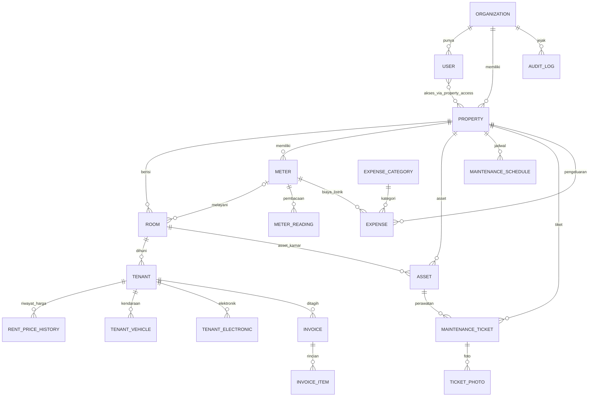

# PRD: Aplikasi Manajemen Kost

**Versi:** 0.2 (draft untuk vibe coding)
**Tanggal:** 7 November 2026
**Perubahan 0.2:** filter properti per halaman menggantikan pemilih properti global (FR-PRO-02, FR-PRO-06, BR-16).
**Nama produk:** belum ditentukan
**Bahasa antarmuka:** Indonesia

---

## 0. Cara Memakai Dokumen Ini

Dokumen ini ditulis supaya bisa diberikan ke AI coding assistant per bagian. Setiap poin diberi label asalnya:

| Label         | Arti                                                                           |
| ------------- | ------------------------------------------------------------------------------ |
| **[PUTUSAN]** | Sudah diputuskan oleh pemilik produk                                           |
| **[ASUMSI]**  | Asumsi penulis PRD supaya coding bisa jalan. Perlu dikonfirmasi, boleh diganti |
| **[TERBUKA]** | Belum diputuskan. Ada default sementara di Bagian 13                           |

Setiap kebutuhan fungsional punya ID (misalnya `FR-TEN-03`) supaya mudah dirujuk saat membuat prompt, tugas, atau test. Aturan bisnis lintas modul punya ID `BR-xx`.

**Saran penggunaan:** jangan kirim seluruh dokumen sekaligus. Kirim Bagian 1 sampai 6 sebagai konteks tetap, lalu satu modul dari Bagian 7 per tahap pembangunan (urutan ada di Bagian 12).

---

## 1. Ringkasan Produk

### 1.1 Masalah

Pemilik kost, terutama yang punya beberapa lokasi, biasanya mencatat penghuni, pembayaran, kerusakan, dan pengeluaran di buku, Excel, atau chat WhatsApp. Akibatnya sulit tahu siapa yang belum bayar, kondisi tiap kamar dan asset, serta berapa pemasukan dan pengeluaran bulan ini, apalagi kalau pengelolanya orang lain.

### 1.2 Solusi

Aplikasi web (mobile dan desktop) yang dipakai **owner** dan **pengelola**. Pengelola mencatat operasional harian (tenant, kamar, tagihan, listrik, asset, perawatan, pengeluaran). Owner bisa melakukan semua yang dilakukan pengelola, serta memantau lewat dashboard dan laporan bulanan dan mengelola akun, dengan riwayat perubahan (audit log) supaya pekerjaan semua pengguna bisa dipantau.

### 1.3 Tujuan Fase 1

1. Pengelola bisa mencatat seluruh siklus sewa bulanan satu tenant dari masuk sampai keluar.
2. Owner bisa melihat laporan bulanan per properti atau gabungan tanpa bertanya ke pengelola.
3. Kondisi asset dan perawatan terdokumentasi, termasuk foto sebelum dan sesudah perbaikan.
4. Mendukung satu owner dengan banyak properti, dan satu produk yang dipakai banyak owner dengan data terpisah.

### 1.4 Bukan Tujuan Fase 1 (Non-goals)

- Booking online oleh calon penyewa.
- Akses login untuk tenant.
- Deposit dan perhitungan saat tenant keluar.
- Pemasukan selain sewa dan listrik (denda, parkir, laundry, tamu).
- Pembayaran sebagian, denda keterlambatan, dan bayar di muka (dicatat di luar sistem).
- Pembayaran online (payment gateway), pengiriman WhatsApp otomatis, impor data, pekerjaan terjadwal (cron), dan aplikasi native.

### 1.5 Ukuran Keberhasilan [ASUMSI]

- Pengelola bisa membuat tenant baru lengkap dengan tagihan pertama dalam kurang dari 3 menit.
- Pengelola bisa mencatat pembayaran beserta foto bukti dalam kurang dari 1 menit.
- Owner bisa membuka laporan bulanan dan mengekspornya dalam kurang dari 30 detik.
- Tidak ada perubahan status pembayaran yang terjadi tanpa jejak di audit log.

---

## 2. Pengguna dan Peran

### 2.1 Peran

| Peran         | Siapa                         | Tugas utama                                                                                                                                                    |
| ------------- | ----------------------------- | -------------------------------------------------------------------------------------------------------------------------------------------------------------- |
| **Owner**     | Pemilik kost                  | Akses penuh: semua menu operasional seperti pengelola, ditambah dashboard, laporan, audit log, serta mengelola akun (properti, pengguna, akses) dan pengaturan |
| **Pengelola** | Penjaga atau pengelola harian | Mengisi semua data operasional untuk properti yang menjadi tanggung jawabnya                                                                                   |
| **Tenant**    | Penghuni kamar                | **Belum punya akses.** Hanya menjadi data. Laporan kerusakan disampaikan ke pengelola, lalu pengelola yang input atas nama tenant                              |

**[PUTUSAN]** Owner bisa melakukan semuanya: semua kemampuan pengelola untuk seluruh propertinya, ditambah mengelola akun, pengaturan, dan audit log. Pengelola mengisi data operasional harian untuk properti yang ditugaskan.
**[ASUMSI]** Hanya owner yang boleh membuat properti, membuat akun pengelola, dan mengatur akses pengelola per properti.
**[TERBUKA]** Apakah satu pengelola bisa memegang beberapa properti. Model data dibuat siap untuk itu (relasi banyak-ke-banyak), antarmuka menyediakan filter properti di setiap halaman daftar, termasuk "Semua properti saya" (FR-PRO-02, FR-PRO-06).

### 2.2 Matriks Hak Akses

C = buat, R = lihat, U = ubah, D = hapus (soft delete). Tanda "-" berarti tidak ada akses.

| Sumber daya                                                               | Owner   | Pengelola (properti yang diberi akses) |
| ------------------------------------------------------------------------- | ------- | -------------------------------------- |
| Properti                                                                  | C R U   | R                                      |
| Pengguna dan akses pengelola                                              | C R U   | -                                      |
| Kamar                                                                     | C R U D | C R U D                                |
| Tenant (termasuk foto dan NIK)                                            | C R U   | C R U                                  |
| Tagihan dan pembayaran                                                    | C R U   | C R U                                  |
| Meteran listrik                                                           | C R U   | C R U                                  |
| Asset                                                                     | C R U D | C R U D                                |
| Maintenance (tiket dan jadwal)                                            | C R U   | C R U                                  |
| Pengeluaran                                                               | C R U D | C R U D                                |
| Dashboard dan laporan                                                     | R       | R                                      |
| Ekspor PDF dan Excel                                                      | Ya      | Ya                                     |
| Audit log                                                                 | R       | -                                      |
| Pengaturan (pengaturan properti, kategori pengeluaran, template WhatsApp) | C R U   | R                                      |

Aturan pembatasan:

- Pengelola hanya melihat dan mengubah data properti yang ditugaskan kepadanya.
- Owner mengakses semua properti miliknya dengan kemampuan penuh, dan bisa memfilter per properti atau gabungan.
- Semua perubahan oleh siapa pun, termasuk owner, tercatat di audit log.
- Data satu owner tidak boleh terlihat oleh owner lain dalam kondisi apa pun.

---

## 3. Glosarium

| Istilah         | Arti                                                                                                     |
| --------------- | -------------------------------------------------------------------------------------------------------- |
| Properti        | Satu bangunan kost dengan satu alamat                                                                    |
| Fasum           | Fasilitas umum: dapur, mesin cuci, CCTV, ruang tamu, dll.                                                |
| Tenant          | Penghuni yang menyewa kamar                                                                              |
| Periode         | Bulan tagihan, format `YYYY-MM`                                                                          |
| Tanggal tagihan | Tanggal jatuh tempo bulanan milik masing-masing tenant                                                   |
| Token           | Pembelian listrik prabayar                                                                               |
| IPL             | Iuran pengelolaan lingkungan (keamanan, kebersihan, sampah)                                              |
| Scheduled       | Perawatan rutin terjadwal                                                                                |
| Accidental      | Kerusakan tak terduga                                                                                    |
| Meteran         | Meteran listrik fisik di properti. Bisa melayani satu kamar, beberapa kamar (bersama), atau khusus fasum |
| Pola listrik    | Paket pengaturan listrik siap pilih (Lampiran C) yang mengisi nilai awal saat properti dibuat            |

---

## 4. Ruang Lingkup

### 4.1 Masuk fase 1

Autentikasi dan peran, multi-properti, kamar, tenant, tagihan dan pembayaran bulanan, bukti bayar, pengingat WhatsApp manual, tenant keluar, pengaturan properti, listrik (pola siap pilih dan daftar meteran), asset kamar dan fasum (jika ada fasum), maintenance (terjadwal dan tak terduga) dengan foto sebelum dan sesudah, pengeluaran operasional, dashboard, laporan bulanan dengan ekspor PDF dan Excel, audit log.

### 4.2 Ditunda

Booking online, akses tenant, deposit, pemasukan selain sewa, pembayaran sebagian dan denda, impor data, pengiriman WhatsApp otomatis, penagihan biaya kerusakan ke tenant, menu riwayat penghuni per kamar.

---

## 5. Aturan Bisnis Global

| ID    | Aturan                                                                                                                                                                                           | Label   |
| ----- | ------------------------------------------------------------------------------------------------------------------------------------------------------------------------------------------------ | ------- |
| BR-01 | Satu kamar hanya boleh punya **satu tenant aktif**. Jika penghuninya lebih dari satu orang, dicatat di kolom catatan tenant                                                                      | PUTUSAN |
| BR-02 | Tanggal tagihan ditentukan **per tenant**, bukan satu tanggal untuk semua                                                                                                                        | PUTUSAN |
| BR-03 | Tagihan fase 1 hanya untuk sewa bulanan dan listrik. Pembayaran sebagian, denda, dan bayar di muka dicatat di luar sistem. Satu tagihan dicatat lunas penuh atau belum                           | PUTUSAN |
| BR-04 | Tenant hanya bisa dinyatakan keluar jika semua tagihannya lunas. Setelah itu kamar otomatis menjadi _available_                                                                                  | PUTUSAN |
| BR-05 | Biaya perbaikan, termasuk kerusakan akibat tenant, ditanggung pemilik dan dicatat sebagai pengeluaran                                                                                            | PUTUSAN |
| BR-06 | Harga sewa disimpan per tenant. Perubahan harga bisa untuk semua tenant atau tenant tertentu, dan setiap perubahan tercatat dengan tanggal mulai berlaku                                         | PUTUSAN |
| BR-07 | Siapa yang menanggung listrik ditentukan per kasus, per tenant. Bentuk meteran dan sistem PLN (token atau pascabayar) ditentukan per meteran                                                     | PUTUSAN |
| BR-08 | Perubahan data penting selalu masuk audit log                                                                                                                                                    | PUTUSAN |
| BR-09 | Tagihan dan pembayaran **tidak boleh dihapus permanen**. Koreksi dilakukan dengan status `VOID` atau pembatalan pembayaran yang tercatat di audit log                                            | ASUMSI  |
| BR-10 | Status "terlambat" tidak disimpan, tetapi dihitung: tagihan `UNPAID` dan tanggal hari ini lebih besar dari tanggal jatuh tempo                                                                   | ASUMSI  |
| BR-11 | Jika tanggal tagihan lebih besar dari jumlah hari dalam bulan (misalnya tanggal 31), jatuh tempo jatuh di hari terakhir bulan itu                                                                | ASUMSI  |
| BR-12 | Semua nilai uang disimpan sebagai **bilangan bulat rupiah** (tanpa desimal)                                                                                                                      | ASUMSI  |
| BR-13 | Semua tanggal memakai zona waktu **Asia/Jakarta (WIB)**                                                                                                                                          | ASUMSI  |
| BR-14 | Data yang dihapus memakai soft delete (`deleted_at`), kecuali foto yang diganti                                                                                                                  | ASUMSI  |
| BR-15 | Aplikasi dipakai banyak owner. Perbedaan kondisi antar owner (ada tidaknya fasum, bentuk meteran, penanggung listrik) diatur sebagai **pengaturan per properti**, bukan fitur terpisah per owner | PUTUSAN |
| BR-16 | Menu dan fitur yang tidak relevan (fasum, listrik) disembunyikan sesuai pengaturan properti. Menu tampil jika minimal satu properti yang dapat diakses pengguna mengaktifkannya. Di dalam halaman, fitur itu hanya berlaku untuk properti yang mengaktifkannya | ASUMSI  |
| BR-17 | Fase 1 hanya mendukung pola listrik di Lampiran C. Kasus di luar pola dicatat di kolom catatan atau di luar sistem. Pola baru ditambah jika ada pemilik yang benar-benar membutuhkannya          | ASUMSI  |
| BR-18 | Fase 1 **tanpa pekerjaan terjadwal (cron)**. Tindakan yang bergantung pada waktu dipicu saat halaman dibuka atau lewat tombol                                                                    | PUTUSAN |

---

## 6. Model Data

### 6.1 Diagram Relasi



### 6.2 Entitas dan Field

Semua tabel memiliki `id` (UUID), `created_at`, `updated_at`, dan `deleted_at` (nullable) kecuali dinyatakan lain.

**organizations**: `name`, `reminder_template` (teks template WhatsApp).

**users**: `organization_id`, `name`, `username` (unik di seluruh sistem, huruf kecil), `phone`, `role` (`OWNER` | `MANAGER`), `is_active`, `must_change_password`. Fase 1 **tanpa email**. Kata sandi hanya disimpan sebagai hash, tidak pernah sebagai teks biasa.

**properties**: `organization_id`, `name`, `address`, `notes`, `is_active`, `has_facilities` (boolean, ada fasum atau tidak), `electricity_managed` (boolean, listrik dikelola aplikasi atau tidak), `electricity_pattern` (`A` | `B` | `C` | `D` | `E` | `CUSTOM`, pola yang dipilih saat setup).

**property_access**: `user_id`, `property_id`. Owner otomatis punya akses ke semua properti organisasinya, tidak perlu baris di tabel ini.

**rooms**: `property_id`, `code` (nomor atau nama kamar, unik per properti), `room_type` (teks bebas), `base_rent_amount`, `facilities` (teks), `meter_id` (nullable, meteran yang melayani kamar), `status` (`AVAILABLE` | `OCCUPIED` | `BROKEN`), `notes`.

**tenants**: `property_id`, `room_id`, `full_name`, `phone_whatsapp`, `nik`, `photo_path`, `move_in_date`, `move_out_date` (nullable), `status` (`ACTIVE` | `CHECKED_OUT`), `billing_day` (1 sampai 31), `rent_amount`, `electricity_payer` (`OWNER` | `TENANT_BILLED` | `TENANT_DIRECT`), `electricity_billing_method` (`PER_KWH` | `FLAT`, hanya jika `TENANT_BILLED`), `electricity_rate` (tarif per kWh atau nominal flat), `notes`.
Batasan: hanya satu baris `ACTIVE` per `room_id`.

**rent_price_history**: `tenant_id`, `amount`, `effective_from`, `changed_by`.

**tenant_vehicles**: `tenant_id`, `vehicle_type` (`MOTOR` | `MOBIL` | `SEPEDA` | `LAINNYA`), `plate_number`, `notes`. Tenant dianggap "tidak membawa kendaraan" jika tidak ada baris.

**tenant_electronics**: `tenant_id`, `name` (misalnya AC, kulkas), `quantity`, `notes`.

**invoices**: `property_id`, `tenant_id`, `room_id`, `period` (`YYYY-MM`), `due_date`, `total_amount`, `status` (`UNPAID` | `PAID` | `VOID`), `paid_at`, `payment_method` (nullable, lihat pertanyaan terbuka), `payment_proof_path` (nullable), `recorded_by`, `notes`.
Batasan: unik `(tenant_id, period)` untuk status selain `VOID`.

**invoice_items**: `invoice_id`, `item_type` (`RENT` | `ELECTRICITY` | `OTHER`), `description`, `amount`, `meter_reading_id` (nullable).

**meters**: `property_id`, `name`, `meter_type` (`ROOM` | `SHARED` | `FASUM`), `pln_system` (`PREPAID_TOKEN` | `POSTPAID`), `meter_number` (nomor meteran atau ID pelanggan PLN, opsional), `is_active`, `notes`. Meteran `ROOM` melayani tepat satu kamar, `SHARED` melayani dua kamar atau lebih, `FASUM` tidak melayani kamar mana pun. Satu kamar dilayani paling banyak satu meteran.

**meter_readings**: `meter_id`, `period`, `reading_date`, `previous_kwh`, `current_kwh`, `usage_kwh` (hasil hitung), `photo_path` (nullable), `recorded_by`, `notes`. Unik `(meter_id, period)`.

**expense_categories**: `organization_id`, `name`, `is_system` (kategori bawaan tidak bisa dihapus).

**expenses**: `property_id`, `category_id`, `expense_date`, `amount`, `description`, `electricity_type` (`TOKEN` | `PLN_BILL`, nullable), `meter_id` (nullable, wajib jika kategori Listrik), `receipt_path` (nullable), `recorded_by`.

**assets**: `property_id`, `room_id` (null berarti fasum), `name`, `category` (teks bebas, misalnya Furnitur, Elektronik, Sanitasi), `condition` (`GOOD` | `DAMAGED` | `UNDER_REPAIR`), `purchase_date` (nullable), `photo_path` (nullable), `notes`.

**maintenance_schedules**: `property_id`, `asset_id` (nullable), `title`, `interval_months`, `next_due_date`, `estimated_cost` (nullable), `is_active`.

**maintenance_tickets**: `property_id`, `asset_id` (nullable), `room_id` (nullable), `schedule_id` (nullable), `ticket_type` (`SCHEDULED` | `ACCIDENTAL`), `title`, `description`, `status` (`OPEN` | `IN_PROGRESS` | `DONE` | `CANCELLED`), `reported_at`, `reported_by`, `due_date` (untuk scheduled), `started_at`, `completed_at`, `cost_amount` (nullable), `makes_room_unusable` (boolean), `notes`.

**ticket_photos**: `ticket_id`, `kind` (`BEFORE` | `AFTER`), `file_path`, `uploaded_by`, `uploaded_at`.

**reminder_logs** [ASUMSI]: `invoice_id`, `sent_by`, `created_at`. Mencatat setiap kali tombol pengingat WhatsApp ditekan.

**audit_logs** (tanpa `updated_at` dan `deleted_at`, tidak boleh diubah atau dihapus): `organization_id`, `property_id` (nullable), `actor_id`, `entity_type`, `entity_id`, `action` (`CREATE` | `UPDATE` | `DELETE` | `STATUS_CHANGE` | `VIEW_SENSITIVE`), `before_json`, `after_json`, `created_at`.

### 6.3 Status dan Enum Ringkas

| Objek              | Nilai                                                                                                    |
| ------------------ | -------------------------------------------------------------------------------------------------------- |
| Status kamar       | `AVAILABLE`, `OCCUPIED`, `BROKEN`                                                                        |
| Status tenant      | `ACTIVE`, `CHECKED_OUT`                                                                                  |
| Status tagihan     | `UNPAID`, `PAID`, `VOID` (plus "terlambat" yang dihitung)                                                |
| Kondisi asset      | `GOOD`, `DAMAGED`, `UNDER_REPAIR`                                                                        |
| Status tiket       | `OPEN`, `IN_PROGRESS`, `DONE`, `CANCELLED`                                                               |
| Penanggung listrik | `OWNER`, `TENANT_BILLED` (ditagih lewat tagihan), `TENANT_DIRECT` (penyewa bayar sendiri, tidak dicatat) |
| Jenis meteran      | `ROOM`, `SHARED`, `FASUM`                                                                                |
| Sistem PLN         | `PREPAID_TOKEN`, `POSTPAID`                                                                              |

### 6.4 Kategori Pengeluaran Bawaan

Internet/WiFi, IPL, Air, Listrik, PBB dan pajak, Gaji/honor, Perlengkapan kebersihan dan kebutuhan harian, Perawatan dan perbaikan (diisi dari modul maintenance), Lain-lain. Pengelola dan owner boleh menambah kategori.

---

## 7. Kebutuhan Fungsional

### 7.1 Autentikasi dan Akun

| ID         | Kebutuhan                                                                                                                                                                                                                                                                                                                                       |
| ---------- | ----------------------------------------------------------------------------------------------------------------------------------------------------------------------------------------------------------------------------------------------------------------------------------------------------------------------------------------------- |
| FR-AUTH-01 | Pengguna login dengan **username dan kata sandi**, tanpa email **[PUTUSAN]**. Username: huruf kecil, 3 sampai 30 karakter, hanya huruf, angka, titik, dan garis bawah, unik di seluruh sistem. Kata sandi minimal 10 karakter                                                                                                                   |
| FR-AUTH-02 | Setelah login, pengguna diarahkan sesuai peran: owner ke dashboard gabungan, pengelola ke dashboard properti pertamanya                                                                                                                                                                                                                         |
| FR-AUTH-03 | Owner membuat akun pengelola (nama, username, telepon, kata sandi awal), mengaktifkan atau menonaktifkan akunnya, dan memilih properti yang boleh diakses                                                                                                                                                                                       |
| FR-AUTH-04 | Pengguna yang dinonaktifkan tidak bisa login, tetapi jejaknya di audit log tetap ada                                                                                                                                                                                                                                                            |
| FR-AUTH-05 | Owner bisa mereset kata sandi pengelola dengan kata sandi sementara yang ditampilkan sekali. Kata sandi tidak masuk log dan audit log, tetapi kejadian reset tercatat. Pengguna bisa mengganti kata sandinya sendiri. Reset kata sandi **owner** dilakukan lewat skrip di server oleh pengelola sistem, karena fase 1 tanpa email **[PUTUSAN]** |
| FR-AUTH-06 | Akun yang baru dibuat atau baru direset wajib mengganti kata sandi pada login pertama                                                                                                                                                                                                                                                           |
| FR-AUTH-07 | Menonaktifkan pengguna mengakhiri semua sesi loginnya                                                                                                                                                                                                                                                                                           |

Kriteria diterima:

- Pengelola yang mencoba membuka data properti lain (lewat URL langsung atau API) mendapat penolakan akses.
- Owner A tidak pernah bisa melihat data Owner B.

### 7.2 Properti

| ID        | Kebutuhan                                                                                                                                                                                                            |
| --------- | -------------------------------------------------------------------------------------------------------------------------------------------------------------------------------------------------------------------- |
| FR-PRO-01 | Owner membuat, mengubah, dan menonaktifkan properti (nama, alamat, catatan)                                                                                                                                          |
| FR-PRO-02 | Halaman yang bercakupan properti (Dashboard, Kamar, Tenant, Tagihan, Maintenance, Asset, Listrik, Pengeluaran, Laporan) memiliki **filter properti** di halaman itu, disimpan di URL dan bernilai awal "Semua". **Tidak ada pemilih properti global.** Formulir pembuatan selalu menanyakan properti secara eksplisit. Halaman tingkat organisasi (Properti, Pengguna, Pengaturan, Audit log, Akun) tidak memakai filter ini **[PUTUSAN]** |
| FR-PRO-03 | Properti yang dinonaktifkan tidak muncul di filter dan di pilihan properti pada formulir, tetapi datanya tetap ada di laporan bulan lampau |
| FR-PRO-04 | Saat membuat properti, pengguna mengisi **pengaturan properti** lewat pertanyaan singkat: ada fasum atau tidak, listrik dikelola aplikasi atau tidak, dan pola listrik (Lampiran C). Pengaturan bisa diubah kemudian |
| FR-PRO-05 | Menu dan fitur mengikuti pengaturan properti (BR-16): menu Listrik tampil jika minimal satu properti yang dapat diakses mengaktifkan listrik dikelola aplikasi. Asset dan maintenance fasum hanya berlaku untuk properti yang punya fasum. Di halaman bersyarat, filter hanya menawarkan properti yang mengaktifkannya |
| FR-PRO-06 | Opsi "Semua properti" tersedia untuk owner. Pengelola yang ditugaskan ke lebih dari satu properti melihat "Semua properti saya", yang hanya mencakup properti yang ditugaskan kepadanya. Pengelola dengan satu properti tidak melihat filter, nama propertinya tertulis di header halaman **[ASUMSI]** |

### 7.3 Kamar

| ID         | Kebutuhan                                                                                                                                                                         |
| ---------- | --------------------------------------------------------------------------------------------------------------------------------------------------------------------------------- |
| FR-ROOM-01 | Pengelola membuat dan mengubah kamar: kode, tipe, harga sewa dasar, fasilitas, meteran listrik yang melayani kamar (dipilih dari daftar meteran, jika listrik dikelola), catatan  |
| FR-ROOM-02 | Daftar kamar menampilkan status, nama tenant aktif, dan status pembayaran bulan berjalan. Bisa difilter per properti dan status, dan dicari berdasarkan kode atau nama tenant                   |
| FR-ROOM-03 | Status `OCCUPIED` diatur otomatis saat tenant ditempatkan, dan `AVAILABLE` otomatis saat tenant keluar (BR-04)                                                                    |
| FR-ROOM-04 | Status `BROKEN` hanya bisa diatur manual dan hanya jika kamar **tidak** punya tenant aktif **[ASUMSI]**. Kamar berpenghuni yang ada kerusakan dicatat lewat asset dan maintenance |
| FR-ROOM-05 | Jika tiket maintenance ditandai `makes_room_unusable` dan kamar tidak berpenghuni, status kamar otomatis `BROKEN`, lalu kembali `AVAILABLE` saat tiket `DONE`                     |
| FR-ROOM-06 | Kamar tidak bisa dihapus jika masih punya tenant aktif                                                                                                                            |
| FR-ROOM-07 | Halaman detail kamar menampilkan tenant aktif, daftar asset kamar, riwayat meteran, dan tiket maintenance kamar                                                                   |

### 7.4 Tenant

| ID        | Kebutuhan                                                                                                                                                                                                                                                                                                                                                                                                                                                   |
| --------- | ----------------------------------------------------------------------------------------------------------------------------------------------------------------------------------------------------------------------------------------------------------------------------------------------------------------------------------------------------------------------------------------------------------------------------------------------------------- |
| FR-TEN-01 | Pengelola menambah tenant dengan field: nama lengkap, nomor WhatsApp, NIK, foto, kamar, tanggal masuk, tanggal tagihan, harga sewa, penanggung listrik, catatan                                                                                                                                                                                                                                                                                             |
| FR-TEN-02 | Hanya kamar berstatus `AVAILABLE` yang bisa dipilih. Sistem menolak jika kamar sudah punya tenant aktif (BR-01)                                                                                                                                                                                                                                                                                                                                             |
| FR-TEN-03 | Tanggal tagihan terisi default dari tanggal masuk, tetapi bisa diubah (BR-02)                                                                                                                                                                                                                                                                                                                                                                               |
| FR-TEN-04 | Harga sewa terisi default dari harga dasar kamar, tetapi bisa diubah per tenant (BR-06)                                                                                                                                                                                                                                                                                                                                                                     |
| FR-TEN-05 | Penanggung listrik terisi default dari pola listrik properti (hanya tampil jika listrik dikelola aplikasi). Pilihan: `OWNER`, `TENANT_BILLED` (ditagih lewat tagihan), atau `TENANT_DIRECT` (penyewa bayar sendiri ke PLN dan tidak dicatat). Jika `TENANT_BILLED`, wajib memilih metode (`PER_KWH` atau `FLAT`) dan mengisi tarif atau nominal. `PER_KWH` hanya tersedia jika kamar dilayani meteran jenis `ROOM`. Meteran `SHARED` hanya mendukung `FLAT` |
| FR-TEN-06 | Bagian kendaraan: sakelar "Membawa kendaraan", lalu daftar kendaraan (jenis, plat nomor, catatan)                                                                                                                                                                                                                                                                                                                                                           |
| FR-TEN-07 | Bagian barang elektronik pribadi: sakelar "Membawa barang elektronik sendiri", lalu daftar (nama, jumlah, catatan)                                                                                                                                                                                                                                                                                                                                          |
| FR-TEN-08 | Saat tenant dibuat, sistem otomatis membuat tagihan pertama (lihat 7.5) dan baris pertama di `rent_price_history`                                                                                                                                                                                                                                                                                                                                           |
| FR-TEN-09 | Mengubah harga sewa meminta tanggal mulai berlaku dan menambah baris `rent_price_history`. Tagihan yang sudah dibuat tidak berubah                                                                                                                                                                                                                                                                                                                          |
| FR-TEN-10 | Fitur ubah harga massal: pengelola memilih beberapa tenant atau semua tenant satu properti, memasukkan harga atau persentase baru dan tanggal mulai berlaku                                                                                                                                                                                                                                                                                                 |
| FR-TEN-11 | Daftar tenant bisa dicari (nama, kamar, nomor) dan difilter (properti, aktif, keluar, ada tunggakan)                                                                                                                                                                                                                                                                                                                                                                  |
| FR-TEN-12 | NIK disamarkan di daftar (misalnya hanya 4 digit terakhir). NIK penuh hanya terlihat di halaman detail, oleh pengelola dan owner                                                                                                                                                                                                                                                                                                                            |
| FR-TEN-13 | Foto tenant diunggah dari kamera atau galeri dan disimpan privat (BAGIAN 10.2)                                                                                                                                                                                                                                                                                                                                                                              |

Kriteria diterima:

- Membuat tenant tanpa kamar kosong tidak mungkin dilakukan.
- Nomor WhatsApp dinormalisasi ke format `62xxxxxxxxxx` saat disimpan.
- NIK divalidasi 16 digit angka. Validasi gagal menampilkan pesan yang jelas, bukan menolak diam-diam **[ASUMSI]**.

### 7.5 Tagihan dan Pembayaran

**Aturan pembuatan tagihan**

| ID        | Kebutuhan                                                                                                                                                                                                                                                                                                                                                                                                                                                                                                                                                                      |
| --------- | ------------------------------------------------------------------------------------------------------------------------------------------------------------------------------------------------------------------------------------------------------------------------------------------------------------------------------------------------------------------------------------------------------------------------------------------------------------------------------------------------------------------------------------------------------------------------------ |
| FR-INV-01 | Setiap tenant aktif punya satu tagihan per periode. Periode adalah bulan jatuh tempo, dan jatuh tempo mengikuti `billing_day` tenant (BR-02, BR-11)                                                                                                                                                                                                                                                                                                                                                                                                                            |
| FR-INV-02 | Tagihan pertama dibuat saat tenant dibuat, dengan jatuh tempo = tanggal masuk **[ASUMSI]**                                                                                                                                                                                                                                                                                                                                                                                                                                                                                     |
| FR-INV-03 | Tagihan berikutnya dibuat oleh fungsi `generate_due_invoices`: membuat tagihan untuk semua tenant aktif yang jatuh temponya dalam **7 hari** ke depan **[ASUMSI]** dan belum punya tagihan periode itu, supaya pengelola sempat mengisi meteran dan mengirim pengingat. Di fase 1 fungsi ini dijalankan (a) otomatis saat pengelola atau owner membuka Dashboard atau halaman Tagihan, dan (b) lewat tombol "Buat tagihan bulan ini". **Tanpa pekerjaan terjadwal (cron)** **[PUTUSAN]**. Fungsi bersifat idempoten sehingga cron bisa ditambahkan nanti tanpa mengubah logika |
| FR-INV-04 | Pengelola juga bisa membuat tagihan secara manual untuk satu tenant dan periode tertentu jika belum ada, di samping tombol pembuatan massal pada FR-INV-03                                                                                                                                                                                                                                                                                                                                                                                                                     |
| FR-INV-05 | Tagihan berisi rincian: baris `RENT` (harga sewa berlaku pada tanggal jatuh tempo, mengacu `rent_price_history`), baris `ELECTRICITY` jika penanggung listrik `TENANT_BILLED`, dan baris `OTHER` yang boleh ditambah pengelola                                                                                                                                                                                                                                                                                                                                                 |
| FR-INV-06 | Selama tagihan `UNPAID`, pengelola boleh menambah, mengubah, atau menghapus baris `OTHER`. Cara ini juga dipakai untuk memasukkan hitungan listrik terakhir secara manual saat tenant keluar                                                                                                                                                                                                                                                                                                                                                                                   |
| FR-INV-07 | Total tagihan selalu sama dengan jumlah semua baris rincian                                                                                                                                                                                                                                                                                                                                                                                                                                                                                                                    |
| FR-INV-08 | Tagihan `PAID` tidak bisa diubah rinciannya. Koreksi dilakukan dengan membatalkan pembayaran (kembali `UNPAID`, tercatat di audit log) lalu mengubah                                                                                                                                                                                                                                                                                                                                                                                                                           |
| FR-INV-09 | Tagihan salah dibuat dibatalkan dengan status `VOID` beserta alasan (BR-09)                                                                                                                                                                                                                                                                                                                                                                                                                                                                                                    |

**Pencatatan pembayaran**

| ID        | Kebutuhan                                                                                                                                                       |
| --------- | --------------------------------------------------------------------------------------------------------------------------------------------------------------- |
| FR-PAY-01 | Pengelola menandai tagihan lunas dengan mengisi tanggal bayar. Nominal otomatis sama dengan total tagihan (tanpa pembayaran sebagian, BR-03)                    |
| FR-PAY-02 | Pengelola bisa mengunggah foto bukti pembayaran (struk transfer, kwitansi). Foto bersifat **opsional di fase 1** karena baru "mungkin" diwajibkan **[TERBUKA]** |
| FR-PAY-03 | Riwayat pembayaran per tenant menampilkan semua tagihan beserta status, tanggal bayar, dan tautan ke foto bukti                                                 |
| FR-PAY-04 | Daftar tagihan bisa difilter: periode, properti, status (lunas, belum, terlambat), dan dicari per tenant atau kamar                                             |
| FR-PAY-05 | Badge "terlambat" muncul otomatis sesuai BR-10, disertai jumlah hari keterlambatan                                                                              |
| FR-PAY-06 | Setiap perubahan status tagihan, nominal, atau pembatalan pembayaran masuk audit log dengan nilai sebelum dan sesudah                                           |

**Kriteria diterima:**

- Dua tagihan untuk tenant dan periode yang sama tidak bisa ada bersamaan (selain yang `VOID`).
- Tenant dengan `billing_day = 31` mendapat jatuh tempo 30 November dan 28 atau 29 Februari.
- Fungsi pembuatan tagihan yang dijalankan berulang atau bersamaan (misalnya dua pengguna membuka dashboard di waktu yang sama) tidak membuat tagihan ganda (idempoten).

### 7.6 Pengingat Tagihan WhatsApp (Manual) **[PUTUSAN]**

| ID        | Kebutuhan                                                                                                                                            |
| --------- | ---------------------------------------------------------------------------------------------------------------------------------------------------- |
| FR-REM-01 | Di daftar dan detail tagihan berstatus `UNPAID`, tersedia tombol "Kirim pengingat WhatsApp"                                                          |
| FR-REM-02 | Tombol membuka tautan `https://wa.me/<nomor>?text=<pesan>` dengan pesan dari template yang sudah terisi. Pengelola tinggal menekan kirim di WhatsApp |
| FR-REM-03 | Template mendukung variabel: `{nama}`, `{kamar}`, `{nama_kost}`, `{periode}`, `{nominal}`, `{jatuh_tempo}`                                           |
| FR-REM-04 | Template bawaan tersedia (Lampiran A). Owner dan pengelola boleh mengeditnya di Pengaturan **[ASUMSI]**                                              |
| FR-REM-05 | Setiap penekanan tombol dicatat di `reminder_logs`, dan tagihan menampilkan "pengingat terakhir dikirim: tanggal" **[ASUMSI]**                       |
| FR-REM-06 | Pengiriman otomatis tidak termasuk fase 1                                                                                                            |

### 7.7 Tenant Keluar

| ID        | Kebutuhan                                                                                                                                                                                                                       |
| --------- | ------------------------------------------------------------------------------------------------------------------------------------------------------------------------------------------------------------------------------- |
| FR-OUT-01 | Pengelola memilih aksi "Tenant keluar" dan mengisi tanggal keluar                                                                                                                                                               |
| FR-OUT-02 | Sistem menolak jika masih ada tagihan `UNPAID` untuk tenant itu, dan menampilkan daftar tagihannya (BR-04)                                                                                                                      |
| FR-OUT-03 | Jika semua lunas: status tenant menjadi `CHECKED_OUT`, `move_out_date` terisi, status kamar menjadi `AVAILABLE`, dan pembuatan tagihan berikutnya berhenti                                                                      |
| FR-OUT-04 | Listrik terakhir untuk tenant dengan penanggung `TENANT_BILLED`: **default sementara** dihitung manual oleh pengelola dan dimasukkan sebagai baris `OTHER` pada tagihan terakhir sebelum tenant dinyatakan keluar **[TERBUKA]** |
| FR-OUT-05 | Data tenant yang sudah keluar tetap tersimpan dan terlihat di riwayat dan laporan bulan lampau                                                                                                                                  |

### 7.8 Listrik

Menu Listrik hanya tampil jika minimal satu properti yang dapat diakses pengguna mengaktifkan "listrik dikelola aplikasi" (FR-PRO-05). Tiga hal diatur terpisah, sehingga berbagai kondisi pemilik kost bisa tertampung tanpa kode khusus (BR-15):

| Yang diatur              | Pilihan                                                                                                  | Diatur di                                         |
| ------------------------ | -------------------------------------------------------------------------------------------------------- | ------------------------------------------------- |
| Siapa yang menanggung    | `OWNER`, `TENANT_BILLED` (ditagih lewat tagihan), `TENANT_DIRECT` (penyewa bayar sendiri, tidak dicatat) | Per tenant. Nilai awal dari pola listrik properti |
| Sistem pembayaran ke PLN | `PREPAID_TOKEN`, `POSTPAID`                                                                              | Per meteran                                       |
| Bentuk meteran           | `ROOM` (satu kamar), `SHARED` (beberapa kamar), `FASUM`                                                  | Per meteran                                       |

Pola siap pilih ada di Lampiran C.

**[PUTUSAN] Penyewa yang membayar sendiri.** Jika penyewa menanggung listrik dan membeli token (atau membayar PLN) sendiri, tenant memakai `TENANT_DIRECT`: berapa pun token yang diisi penyewa berada di luar sistem dan tidak dicatat. `TENANT_BILLED` hanya dipakai jika **pemilik yang membayar PLN lalu menagih biayanya ke penyewa** lewat tagihan bulanan. Pada meteran `PREPAID_TOKEN`, nilai awal penanggung untuk tenant yang menanggung sendiri adalah `TENANT_DIRECT`, bukan `TENANT_BILLED`.

**Daftar meteran**

| ID        | Kebutuhan                                                                                                                                                                                                                                                 |
| --------- | --------------------------------------------------------------------------------------------------------------------------------------------------------------------------------------------------------------------------------------------------------- |
| FR-ELC-01 | Pengelola mendaftarkan meteran: nama, jenis, sistem PLN, nomor meteran (opsional), dan kamar yang dilayani (satu kamar untuk `ROOM`, dua atau lebih untuk `SHARED`, tidak ada untuk `FASUM`). Meteran `FASUM` hanya bisa dibuat jika properti punya fasum |
| FR-ELC-02 | Satu kamar dilayani paling banyak satu meteran. Kamar tanpa meteran terdaftar boleh ada, misalnya kamar dengan tenant `TENANT_DIRECT`                                                                                                                     |
| FR-ELC-03 | Meteran yang masih melayani kamar berpenghuni atau sudah punya riwayat tidak bisa dihapus, hanya dinonaktifkan                                                                                                                                            |

**Pencatatan angka meteran**

| ID        | Kebutuhan                                                                                                                                                                                                                                                                                        |
| --------- | ------------------------------------------------------------------------------------------------------------------------------------------------------------------------------------------------------------------------------------------------------------------------------------------------ |
| FR-ELC-04 | Pengelola mencatat angka per meteran per periode: tanggal, angka sekarang, foto meteran (opsional). Angka sebelumnya terisi otomatis dari pembacaan terakhir. Wajib untuk meteran `ROOM` milik tenant `TENANT_BILLED` dengan metode `PER_KWH`, opsional untuk lainnya (untuk memantau pemakaian) |
| FR-ELC-05 | Sistem menolak angka sekarang yang lebih kecil dari angka sebelumnya, kecuali ditandai "meteran diganti atau direset" dengan angka awal baru **[ASUMSI]**                                                                                                                                        |
| FR-ELC-06 | Pemakaian kWh dihitung otomatis dari selisih angka                                                                                                                                                                                                                                               |

**Biaya ke PLN (pengeluaran pemilik)**

| ID        | Kebutuhan                                                                                                                                                                                                                                                                                                                                   |
| --------- | ------------------------------------------------------------------------------------------------------------------------------------------------------------------------------------------------------------------------------------------------------------------------------------------------------------------------------------------- |
| FR-ELC-07 | Pembelian token (`PREPAID_TOKEN`) atau pembayaran tagihan PLN (`POSTPAID`) dicatat dengan memilih meteran, tanggal, nominal, dan foto struk (opsional). Disimpan sebagai pengeluaran kategori Listrik dengan `meter_id`, sehingga masuk laporan pengeluaran tanpa input ganda. Jenis (`TOKEN` atau `PLN_BILL`) mengikuti sistem PLN meteran |
| FR-ELC-08 | Pengeluaran listrik diberi label sesuai jenis meteran (kamar, bersama, fasum) untuk ringkasan dan laporan                                                                                                                                                                                                                                   |
| FR-ELC-09 | Untuk tenant `TENANT_DIRECT`, tidak ada pencatatan biaya listrik                                                                                                                                                                                                                                                                            |

**Tagihan listrik ke tenant**

| ID        | Kebutuhan                                                                                                                                                                                                                                                                                         |
| --------- | ------------------------------------------------------------------------------------------------------------------------------------------------------------------------------------------------------------------------------------------------------------------------------------------------- |
| FR-ELC-10 | Hanya untuk tenant `TENANT_BILLED`. Metode `PER_KWH`: pemakaian kWh meteran `ROOM` dikali tarif. Metode `FLAT`: nominal tetap per bulan tanpa perlu angka meteran, dan satu-satunya metode untuk kamar yang dilayani meteran `SHARED`. Pembagian rata biaya meteran bersama ditunda **[TERBUKA]** |
| FR-ELC-11 | Saat angka meteran disimpan dan tagihan periode itu masih `UNPAID`, baris `ELECTRICITY` ditambahkan atau diperbarui. Jika tagihan sudah `PAID`, sistem menampilkan peringatan dan tidak mengubahnya otomatis                                                                                      |
| FR-ELC-12 | Jika metode `PER_KWH` tetapi angka meteran belum dicatat saat tagihan dibuat, tagihan dibuat tanpa baris listrik dan pengelola diingatkan untuk mencatatnya                                                                                                                                       |

**Ringkasan**

| ID        | Kebutuhan                                                                                                                                                 |
| --------- | --------------------------------------------------------------------------------------------------------------------------------------------------------- |
| FR-ELC-13 | Halaman Listrik menampilkan per meteran: pemakaian bulan itu (jika ada angka), biaya PLN bulan itu, serta total biaya per label kamar, bersama, dan fasum |

### 7.9 Asset

| ID        | Kebutuhan                                                                                                                                                                                               |
| --------- | ------------------------------------------------------------------------------------------------------------------------------------------------------------------------------------------------------- |
| FR-AST-01 | Pengelola mencatat asset kamar (terhubung ke `room_id`) dan asset fasum (`room_id` kosong, hanya jika properti punya fasum): nama, kategori, kondisi, tanggal beli (opsional), foto (opsional), catatan |
| FR-AST-02 | Kondisi asset: `GOOD`, `DAMAGED`, `UNDER_REPAIR`. Perubahan kondisi masuk audit log                                                                                                                     |
| FR-AST-03 | Daftar asset bisa difilter: properti, kamar atau fasum, kondisi, kategori                                                                                                                               |
| FR-AST-04 | Kondisi asset otomatis mengikuti tiket maintenance: tiket kerusakan dibuat berarti `DAMAGED`, tiket `IN_PROGRESS` berarti `UNDER_REPAIR`, tiket `DONE` berarti `GOOD`                                   |
| FR-AST-05 | Halaman detail asset menampilkan riwayat tiket perawatan beserta biaya                                                                                                                                  |

### 7.10 Maintenance

Ada dua jenis, masing-masing dengan biayanya sendiri (**[PUTUSAN]**):

| Jenis        | Pemicu                                                              | Biaya                       |
| ------------ | ------------------------------------------------------------------- | --------------------------- |
| `SCHEDULED`  | Jadwal rutin per asset atau fasum (misalnya servis AC tiap 3 bulan) | Dicatat di tiketnya sendiri |
| `ACCIDENTAL` | Kerusakan tak terduga dilaporkan                                    | Dicatat di tiketnya sendiri |

**Perawatan terjadwal**

| ID        | Kebutuhan                                                                                                                                                                                                                                                                                  |
| --------- | ------------------------------------------------------------------------------------------------------------------------------------------------------------------------------------------------------------------------------------------------------------------------------------------ |
| FR-MNT-01 | Pengelola membuat jadwal perawatan: judul, asset (opsional, bisa fasum), interval dalam bulan, tanggal jatuh tempo berikutnya, estimasi biaya (opsional)                                                                                                                                   |
| FR-MNT-02 | Tidak ada pembuatan tiket otomatis di fase 1 **[PUTUSAN]**. Jadwal yang jatuh tempo dalam 7 hari **[ASUMSI]** atau sudah lewat ditampilkan di dashboard dan daftar jadwal, dihitung dari `next_due_date`. Pengelola membuat tiket `SCHEDULED` dari jadwal lewat tombol "Kerjakan sekarang" |
| FR-MNT-03 | Saat tiket terjadwal diselesaikan, pengelola mengisi biaya aktual, lalu `next_due_date` jadwal maju sebesar interval                                                                                                                                                                       |
| FR-MNT-04 | Jadwal yang sudah lewat `next_due_date` tanpa tiket yang selesai ditandai "terlambat"                                                                                                                                                                                                      |

**Kerusakan tak terduga (alur foto)**

| ID        | Kebutuhan                                                                                                                                     |
| --------- | --------------------------------------------------------------------------------------------------------------------------------------------- |
| FR-MNT-05 | Pengelola membuat tiket `ACCIDENTAL`: judul, deskripsi, asset atau kamar terkait, dan **minimal satu foto kondisi rusak** (jenis `BEFORE`)    |
| FR-MNT-06 | Status berjalan `OPEN` → `IN_PROGRESS` → `DONE`, atau `CANCELLED` dengan alasan. Setiap perubahan masuk audit log                             |
| FR-MNT-07 | Tiket tidak bisa ditutup (`DONE`) tanpa minimal satu foto setelah perbaikan (jenis `AFTER`) dan biaya terisi (boleh 0)                        |
| FR-MNT-08 | Halaman tiket menampilkan foto sebelum dan sesudah berdampingan                                                                               |
| FR-MNT-09 | Kerusakan dari laporan tenant diinput pengelola atas nama tenant, dengan kolom "dilaporkan oleh" berisi nama tenant bila relevan **[ASUMSI]** |
| FR-MNT-10 | Saat tiket `DONE`, biayanya otomatis dihitung sebagai pengeluaran kategori "Perawatan dan perbaikan" di laporan, tanpa input ganda (BR-05)    |
| FR-MNT-11 | Daftar tiket bisa difilter: jenis, status, properti, kamar atau fasum, periode. Daftar jadwal bisa difilter per properti                                                                |

### 7.11 Pengeluaran Operasional

| ID        | Kebutuhan                                                                                             |
| --------- | ----------------------------------------------------------------------------------------------------- |
| FR-EXP-01 | Pengelola mencatat pengeluaran: properti, kategori, tanggal, nominal, deskripsi, foto nota (opsional) |
| FR-EXP-02 | Kategori bawaan di 6.4. Kategori baru bisa ditambah, kategori bawaan tidak bisa dihapus               |
| FR-EXP-03 | Pengeluaran kategori Listrik mengharuskan memilih meteran (lihat 7.8)                                 |
| FR-EXP-04 | Daftar pengeluaran bisa difilter: bulan, properti, kategori. Menampilkan total per filter             |
| FR-EXP-05 | Pengeluaran bisa diubah dan dihapus (soft delete). Setiap perubahan masuk audit log                   |
| FR-EXP-06 | Biaya tiket maintenance **tidak** dicatat ulang di sini. Laporan menggabungkan keduanya (FR-MNT-10)   |

### 7.12 Dashboard dan Laporan

**Dashboard (owner dan pengelola)** **[ASUMSI]**

| Widget                | Isi                                                                                                 |
| --------------------- | --------------------------------------------------------------------------------------------------- |
| Pembayaran bulan ini  | Jumlah dan nominal tagihan lunas, belum, dan terlambat                                              |
| Status kamar          | Jumlah kamar `AVAILABLE`, `OCCUPIED`, `BROKEN`                                                      |
| Jatuh tempo dekat     | Tagihan jatuh tempo dalam 7 hari                                                                    |
| Tunggakan             | Daftar tagihan terlambat, diurutkan paling lama                                                     |
| Maintenance           | Jumlah tiket `OPEN`, `IN_PROGRESS`, dan terlambat, serta jadwal rutin yang jatuh tempo dalam 7 hari |
| Pengeluaran bulan ini | Total dan rincian per kategori                                                                      |

**Laporan bulanan**

| ID        | Kebutuhan                                                                                                                                                          |
| --------- | ------------------------------------------------------------------------------------------------------------------------------------------------------------------ |
| FR-REP-01 | Pengguna memilih bulan dan properti ("Semua properti" untuk owner, "Semua properti saya" untuk pengelola). Default: bulan berjalan dan semua properti                                                                   |
| FR-REP-02 | Bagian **Kamar**: daftar kamar dan statusnya, plus ringkasan jumlah terisi, kosong, rusak                                                                          |
| FR-REP-03 | Bagian **Penghuni dan pembayaran**: daftar penghuni aktif dengan kamar, jatuh tempo, nominal tagihan, status bayar, dan tanggal bayar                              |
| FR-REP-04 | Bagian **Pemasukan**: total tagihan jatuh tempo bulan itu, **sudah masuk** (tagihan `PAID`), dan **belum masuk** (`UNPAID`, termasuk yang terlambat) **[PUTUSAN]** |
| FR-REP-05 | Bagian **Pengeluaran**: total per kategori, termasuk biaya perawatan dari tiket `DONE` di bulan itu                                                                |
| FR-REP-06 | Bagian **Maintenance**: jumlah tiket terbuka, sedang proses, dan selesai, plus daftar tiket dengan biaya                                                           |
| FR-REP-07 | Tampilan "Semua properti" menampilkan total gabungan dan rincian per properti                                                                                      |
| FR-REP-08 | Laporan bisa diekspor ke **PDF** dan **Excel (.xlsx)**. Excel punya satu sheet per bagian. NIK **tidak** disertakan di ekspor **[ASUMSI]**                         |
| FR-REP-09 | Kandidat tambahan **[TERBUKA]**: selisih pemasukan dan pengeluaran (laba rugi sederhana) dan tingkat hunian. Disediakan sebagai bagian opsional di bawah ringkasan |

Aturan perhitungan **[ASUMSI]**:

- Pemasukan bulan M = tagihan dengan `due_date` di bulan M (selain `VOID`), dikelompokkan berdasarkan status saat laporan dibuka.
- Pengeluaran bulan M = pengeluaran dengan `expense_date` di bulan M, ditambah tiket maintenance `DONE` dengan `completed_at` di bulan M.

### 7.13 Audit Log

| ID        | Kebutuhan                                                                                                                                                                                                                                                             |
| --------- | --------------------------------------------------------------------------------------------------------------------------------------------------------------------------------------------------------------------------------------------------------------------- |
| FR-AUD-01 | Sistem mencatat otomatis setiap pembuatan, perubahan, penghapusan, dan perubahan status untuk: tagihan, pembayaran, kamar (termasuk status), tenant (termasuk harga sewa dan penanggung listrik), asset (kondisi), tiket maintenance, pengeluaran, pengguna dan akses |
| FR-AUD-02 | Setiap catatan menyimpan: siapa (`actor_id`), kapan, entitas, aksi, nilai sebelum dan sesudah                                                                                                                                                                         |
| FR-AUD-03 | Pencatatan dilakukan di sisi server (bukan hanya di antarmuka) sehingga tidak bisa dilewati                                                                                                                                                                           |
| FR-AUD-04 | Audit log tidak bisa diubah atau dihapus oleh siapa pun lewat aplikasi                                                                                                                                                                                                |
| FR-AUD-05 | Owner membuka halaman Audit Log dengan filter: properti, pengguna, jenis entitas, rentang tanggal                                                                                                                                                                     |
| FR-AUD-06 | Tampilan membaca perubahan dalam bahasa manusia, misalnya "Andi mengubah status tagihan Kamar 3 (Nov 2026) dari Belum bayar menjadi Lunas"                                                                                                                            |
| FR-AUD-07 | Pembukaan data sensitif (NIK penuh dan foto identitas) dicatat sebagai `VIEW_SENSITIVE` **[ASUMSI]**                                                                                                                                                                  |

---

## 8. Layar dan Navigasi

| Layar                                 | Isi utama                                                                                                           | Owner | Pengelola   |
| ------------------------------------- | ------------------------------------------------------------------------------------------------------------------- | ----- | ----------- |
| Login dan ubah kata sandi             | Username, kata sandi                                                                                                | Ya    | Ya          |
| Dashboard                             | Widget 7.12 dan filter properti                                                                                    | Ya    | Ya          |
| Kamar (daftar)                        | Tabel dan kartu kamar, filter status                                                                                | Ya    | Ya          |
| Kamar (detail/form)                   | Data kamar, tenant aktif, asset, meteran, tiket                                                                     | Ya    | Ya          |
| Tenant (daftar)                       | Cari, filter, status pembayaran                                                                                     | Ya    | Ya          |
| Tenant (detail/form)                  | Tab: Profil, Tagihan, Kendaraan dan elektronik, Listrik                                                             | Ya    | Ya          |
| Tagihan                               | Daftar tagihan, filter, tombol bayar dan pengingat                                                                  | Ya    | Ya          |
| Tagihan (detail)                      | Rincian, catat pembayaran, unggah bukti, riwayat pengingat                                                          | Ya    | Ya          |
| Listrik (hanya jika listrik dikelola) | Tab Meteran (daftar meteran dan pencatatan angka), tab Token dan tagihan PLN, ringkasan bulanan                     | Ya    | Ya          |
| Asset                                 | Daftar per kamar dan fasum (jika ada fasum), detail asset                                                           | Ya    | Ya          |
| Maintenance                           | Daftar tiket, detail tiket dengan foto, jadwal rutin                                                                | Ya    | Ya          |
| Pengeluaran                           | Daftar dan form pengeluaran                                                                                         | Ya    | Ya          |
| Laporan                               | Pilih bulan, pratinjau, ekspor PDF dan Excel                                                                        | Ya    | Ya          |
| Audit log                             | Daftar perubahan dengan filter                                                                                      | Ya    | -           |
| Pengaturan                            | Properti dan pengaturan properti (fasum, pola listrik), pengguna dan akses, kategori pengeluaran, template WhatsApp | Ya    | Hanya lihat |

Prinsip antarmuka:

- **Mobile-first untuk pengelola**: tombol besar, form pendek, unggah foto langsung dari kamera.
- Daftar harus tetap nyaman untuk properti besar (ratusan kamar): paginasi atau scroll tak terbatas, pencarian, filter tersimpan.
- Semua nominal tampil dalam format rupiah (`Rp 1.500.000`), tanggal `dd/mm/yyyy`.

---

## 9. Alur Utama

### 9.1 Menyiapkan sistem (owner, sekali di awal)

1. Owner mendaftar dan membuat organisasi.
2. Owner menambah properti dan mengisi pengaturannya (ada fasum atau tidak, pola listrik).
3. Owner membuat akun pengelola (username dan kata sandi awal) dan memilih properti yang boleh diakses.
4. Pengelola login, mendaftarkan meteran (jika listrik dikelola), lalu menambah kamar dan menghubungkannya ke meteran (manual, tanpa impor).

### 9.2 Tenant baru masuk

1. Pengelola membuka Tenant lalu Tambah.
2. Mengisi data diri, memilih kamar kosong, mengunggah foto, mengisi NIK.
3. Mengatur tanggal tagihan, harga sewa, penanggung listrik (dan tarif jika `TENANT_BILLED`).
4. Mengisi kendaraan dan barang elektronik jika ada.
5. Simpan: kamar menjadi `OCCUPIED`, tagihan pertama otomatis dibuat.

### 9.3 Siklus tagihan bulanan

1. Saat pengelola atau owner membuka Dashboard atau halaman Tagihan, sistem membuat tagihan yang jatuh temponya dalam 7 hari. Pengelola juga bisa menekan "Buat tagihan bulan ini".
2. Untuk tenant dengan listrik `TENANT_BILLED`, pengelola mencatat meteran, dan baris listrik masuk ke tagihan.
3. Pengelola menekan "Kirim pengingat WhatsApp", lalu menekan kirim di WhatsApp.
4. Tenant membayar (di luar aplikasi).
5. Pengelola membuka tagihan, menandai lunas, mengisi tanggal bayar, dan mengunggah foto bukti.
6. Jika lewat jatuh tempo dan belum lunas, badge "terlambat" muncul dan tagihan masuk daftar tunggakan.

### 9.4 Kerusakan dan perbaikan

1. Tenant melapor ke pengelola (di luar aplikasi).
2. Pengelola membuat tiket kerusakan, memilih asset atau kamar, mengunggah foto rusak. Asset menjadi `DAMAGED`.
3. Pengelola mengubah status ke `IN_PROGRESS` saat perbaikan dimulai. Asset menjadi `UNDER_REPAIR`.
4. Setelah selesai, pengelola mengunggah foto sesudah perbaikan, mengisi biaya, dan menutup tiket (`DONE`). Asset kembali `GOOD`, biaya masuk laporan pengeluaran.

### 9.5 Tenant keluar

1. Pengelola membuka tenant dan memilih "Tenant keluar".
2. Jika ada tagihan belum lunas, sistem menolak dan menampilkan daftarnya.
3. Pengelola menyelesaikan tagihan (termasuk listrik terakhir yang dimasukkan manual sebagai baris `OTHER`).
4. Pengelola mengisi tanggal keluar. Tenant `CHECKED_OUT`, kamar `AVAILABLE`.

### 9.6 Owner memantau

1. Owner login dan melihat dashboard gabungan.
2. Membuka Laporan, memilih bulan dan properti.
3. Mengekspor PDF atau Excel jika perlu.
4. Membuka Audit Log untuk memeriksa perubahan yang dilakukan pengelola.

---

## 10. Kebutuhan Non-Fungsional

### 10.1 Platform dan Kinerja

- Aplikasi web responsif yang nyaman di HP dan desktop. Bisa dipasang ke layar utama (PWA) sebagai tambahan **[ASUMSI]**. Aplikasi native tidak termasuk fase 1.
- Halaman daftar memuat dalam kurang dari 2 detik untuk properti hingga 500 kamar **[ASUMSI]**.
- Foto dikompres di sisi klien sebelum diunggah (sisi terpanjang sekitar 1600 px), batas 10 MB per file, format JPG, PNG, atau WebP **[ASUMSI]**.

### 10.2 Keamanan dan Data Pribadi

- Aplikasi menyimpan **foto penyewa dan NIK**, termasuk data pribadi **[PUTUSAN]**.
- Isolasi data antar owner dan antar properti diterapkan di lapisan server (setiap query data terikat ke organisasi dan properti yang diizinkan), bukan hanya di antarmuka. Fase 1 tidak memakai row-level security **[PUTUSAN]**.
- Foto dan dokumen disimpan di penyimpanan **privat**. Akses lewat tautan bertanda tangan yang kedaluwarsa singkat. Tidak ada URL publik permanen.
- NIK disimpan terenkripsi atau dengan kontrol akses ketat, disamarkan di daftar, dan tidak ada di ekspor.
- Seluruh lalu lintas memakai HTTPS. Kata sandi tidak disimpan sebagai teks biasa.
- Pembukaan data sensitif masuk audit log (FR-AUD-07).
- Perlu dicek kesesuaiannya dengan UU Pelindungan Data Pribadi sebelum rilis, termasuk persetujuan tenant atas pengumpulan data dan kebijakan retensi.

### 10.3 Keandalan dan Operasional

- Pembuatan tagihan massal (`generate_due_invoices`) bersifat idempoten (aman dijalankan berulang atau bersamaan) dan mencatat hasil eksekusi. Pekerjaan terjadwal (cron) tidak dipakai di fase 1 dan bisa ditambahkan nanti dengan memanggil fungsi yang sama.
- Cadangan database otomatis harian **[ASUMSI]**.
- Semua operasi yang mengubah beberapa tabel sekaligus (misalnya tenant keluar, simpan meteran lalu perbarui tagihan) memakai transaksi database.

### 10.4 Lokalisasi

- Bahasa Indonesia, mata uang rupiah, zona waktu WIB (BR-12, BR-13).

---

## 11. Teknologi **[PUTUSAN]**

Stack sudah diputuskan. Rinciannya, termasuk arsitektur isolasi data dan struktur proyek, ada di `TECH-SPEC.md`.

| Lapisan                  | Putusan                                                                                                                |
| ------------------------ | ---------------------------------------------------------------------------------------------------------------------- |
| Aplikasi                 | Next.js (App Router) sebagai satu aplikasi, TypeScript, Tailwind CSS, shadcn/ui                                        |
| API                      | tRPC                                                                                                                   |
| Form dan validasi        | React Hook Form dan Zod                                                                                                |
| Data dan tabel di klien  | TanStack Query dan TanStack Table                                                                                      |
| Database                 | PostgreSQL (lokal dulu, lalu VPS sendiri)                                                                              |
| ORM dan migrasi          | Drizzle ORM **[ASUMSI]**                                                                                               |
| Autentikasi              | Dibangun sendiri: username dan kata sandi tanpa email, sesi di database **[PUTUSAN]**                                  |
| Arsitektur               | Frontend dan backend dipisah secara folder dan aturan impor. Backend berlapis: controller, service, repository         |
| Isolasi data antar owner | Repository terikat organisasi dan pemeriksaan peran dan properti di server, dibuktikan dengan tes otomatis (tanpa RLS) |
| Penyimpanan file         | Disk privat di VPS lewat lapisan penyimpanan yang bisa diganti ke S3-kompatibel **[ASUMSI]**                           |
| Pekerjaan terjadwal      | Tidak dipakai di fase 1 (BR-18)                                                                                        |
| Ekspor                   | `exceljs` (Excel) dan `@react-pdf/renderer` (PDF)                                                                      |
| Hosting                  | VPS sendiri, Docker Compose, Caddy                                                                                     |

Tampilan dan warna ditetapkan terpisah di `design.md`. Pilihan di atas bisa diganti selama memenuhi isolasi data dan penyimpanan privat.

---

## 12. Urutan Pembangunan untuk Vibe Coding

Bangun per tahap dan uji setiap tahap sebelum lanjut. Setiap tahap bisa diberi bagian PRD yang disebutkan.

| Tahap | Isi                                                                                                   | Bagian PRD yang dikirim ke AI                  | Selesai jika                                                                                                          |
| ----- | ----------------------------------------------------------------------------------------------------- | ---------------------------------------------- | --------------------------------------------------------------------------------------------------------------------- |
| M0    | Fondasi: proyek, autentikasi, organisasi, peran, isolasi data, utilitas audit log, upload file privat | 2, 5, 6, 7.1, 7.13, 10                         | Login berjalan, dua owner terbukti terpisah datanya, perubahan tercatat di `audit_logs`                               |
| M1    | Properti (termasuk pengaturan fasum) dan kamar                                                        | 6.2, 7.2, 7.3                                  | Pengelola bisa mengelola kamar properti yang diberi akses                                                             |
| M2    | Tenant (profil, kendaraan, elektronik, foto, NIK, harga sewa dan riwayatnya)                          | 7.4                                            | Tenant bisa dibuat, kamar jadi `OCCUPIED`, NIK disamarkan                                                             |
| M3    | Tagihan, pembayaran, bukti bayar, status terlambat, pengingat WhatsApp, tenant keluar                 | 7.5, 7.6, 7.7, Lampiran A                      | Siklus 9.3 dan 9.5 berjalan, pembuatan tagihan massal idempoten                                                       |
| M4    | Listrik: pengaturan pola listrik, daftar meteran, pencatatan angka, integrasi ke tagihan              | 7.2 (FR-PRO-04 dan FR-PRO-05), 7.8, Lampiran C | Pola A sampai E berjalan, listrik penyewa muncul di tagihan, pembelian token tercatat sebagai pengeluaran per meteran |
| M5    | Asset, maintenance terjadwal dan tak terduga, foto sebelum dan sesudah                                | 7.9, 7.10                                      | Alur 9.4 berjalan, kondisi asset mengikuti tiket                                                                      |
| M6    | Pengeluaran operasional                                                                               | 7.11                                           | Pengeluaran per kategori dan per bulan bisa dicatat dan difilter                                                      |
| M7    | Dashboard, laporan bulanan, ekspor PDF dan Excel                                                      | 7.12                                           | Laporan memuat angka yang sama dengan data sumber, ekspor terbuka benar                                               |
| M8    | Halaman audit log, pengaturan, perapian, pengujian menyeluruh                                         | 7.13, 8, 10                                    | Semua kriteria diterima lolos                                                                                         |

**Urutan eksekusi [PUTUSAN]:** M0, M1, M2, M3, M5, M6, M4, M7, M8. M4 dikerjakan setelah M6 karena pembelian token dan tagihan PLN dicatat sebagai pengeluaran (FR-ELC-07) dan memakai tabel pengeluaran dari M6. Nomor tahap tidak diubah supaya rujukan tetap sama.

**Ketergantungan lintas tahap:**

- Tagihan pertama saat tenant dibuat (FR-TEN-08, FR-INV-02) dikerjakan di M3. M2 hanya membuat tenant dan baris pertama riwayat harga.
- Kolom status pembayaran di daftar kamar (FR-ROOM-02) dan filter "ada tunggakan" di daftar tenant (FR-TEN-11) menyusul di M3.
- Pemilihan meteran di form kamar (FR-ROOM-01) dan kewajiban memilih meteran pada pengeluaran listrik (FR-EXP-03) diaktifkan di M4.
- Pemicu pembuatan tagihan saat Dashboard dibuka ditambahkan di M7. Di M3 pemicunya halaman Tagihan dan tombol.
- Isi halaman detail kamar (FR-ROOM-07) bertambah bertahap: tenant (M2), asset dan tiket (M5), riwayat meteran (M4).

Tips prompt per tahap:

- Mulai dengan menempelkan Bagian 0 sampai 6 sebagai konteks tetap.
- Minta AI menulis **migrasi database, repository, dan tes isolasi dulu**, baru service, controller, dan antarmuka.
- Minta AI membuat **data contoh** (2 properti, 10 kamar tiap properti, tenant dengan berbagai penanggung listrik dan status bayar) agar setiap tahap bisa diuji secara realistis.
- Minta AI membuat tes untuk aturan bisnis BR-01 sampai BR-18, terutama BR-01, BR-04, dan BR-11.

---

## 13. Pertanyaan Terbuka dan Default Sementara

Default dipakai supaya coding tidak terhenti. Semua bisa diubah setelah ada keputusan.

| No  | Pertanyaan                                                                            | Default sementara untuk coding                                                                                                       |
| --- | ------------------------------------------------------------------------------------- | ------------------------------------------------------------------------------------------------------------------------------------ |
| 1   | Listrik penyewa: tarif per kWh atau flat per bulan?                                   | Dukung **dua-duanya** lewat field `electricity_billing_method`                                                                       |
| 2   | Apakah satu pengelola bisa memegang beberapa properti?                                | Model data **mendukung** banyak-ke-banyak, antarmuka punya filter properti per halaman, termasuk "Semua properti saya"             |
| 3   | Perlu deposit dan perhitungan saat keluar?                                            | **Tidak ada** di fase 1. Struktur dibiarkan longgar                                                                                  |
| 4   | Listrik terakhir saat tenant keluar: dicatat dan ditagihkan bagaimana?                | Dihitung **manual** oleh pengelola dan dimasukkan sebagai baris `OTHER` pada tagihan terakhir (FR-INV-06, FR-OUT-04)                 |
| 5   | Apakah metode pembayaran (transfer, tunai, e-wallet) perlu dicatat selain foto bukti? | Field `payment_method` **tersedia tetapi opsional**                                                                                  |
| 6   | Laporan owner perlu laba rugi dan okupansi?                                           | Tampil sebagai bagian **opsional** di bawah ringkasan (FR-REP-09)                                                                    |
| 7   | Foto bukti bayar wajib atau opsional?                                                 | **Opsional** di fase 1                                                                                                               |
| 8   | Meteran bersama yang biayanya dibebankan ke penyewa: flat per kamar atau bagi rata?   | Fase 1 hanya **flat per kamar**, bagi rata ditunda                                                                                   |
| 9   | Apakah pola listrik A sampai E sudah mencakup kondisi kost target?                    | Divalidasi lewat wawancara 3 sampai 5 pemilik kost sebelum modul listrik dibangun                                                    |
| 10  | Perlu email untuk reset kata sandi mandiri dan undangan?                              | **Tidak** di fase 1. Reset sandi pengelola oleh owner, reset sandi owner lewat skrip di server. Email ditambah nanti jika dibutuhkan |

### Asumsi penulis PRD yang perlu dikonfirmasi

Hal-hal berikut belum pernah diputuskan secara eksplisit dan saya isi sendiri agar PRD lengkap:

1. Pola listrik A sampai E (Lampiran C) adalah tebakan awal dan perlu divalidasi dengan pemilik kost sungguhan.
2. Hanya owner yang boleh membuat properti, membuat akun pengelola, dan mengatur akses mereka.
3. Owner satu-satunya yang melihat audit log, dan pengelola tidak.
4. ~~Login dengan email dan kata sandi.~~ Sudah diputuskan: login dengan username dan kata sandi, tanpa email di fase 1.
5. Tagihan pertama jatuh tempo di tanggal masuk, tagihan berikutnya dibuat 7 hari sebelum jatuh tempo.
6. Penagihan berbasis bulan jatuh tempo, sewa dibayar di awal periode.
7. Kamar berpenghuni tidak bisa berstatus `BROKEN`. Kerusakan dicatat di asset dan tiket.
8. Jendela 7 hari untuk pembuatan tagihan dan untuk pengingat jadwal perawatan.
9. Aturan perhitungan laporan (Bagian 7.12) dan penyamaran NIK di ekspor.
10. Template WhatsApp boleh diedit dan penekanan tombol pengingat dicatat.

---

## Lampiran A: Template Pengingat WhatsApp Bawaan

```
Halo {nama}, kami dari {nama_kost}.

Mengingatkan tagihan kost kamar {kamar} untuk periode {periode}:
Nominal: {nominal}
Jatuh tempo: {jatuh_tempo}

Mohon konfirmasi dan kirim bukti transfer jika sudah dibayar. Terima kasih.
```

## Lampiran B: Kategori Pengeluaran dan Contoh

| Kategori                | Contoh                                                          |
| ----------------------- | --------------------------------------------------------------- |
| Internet/WiFi           | Langganan bulanan                                               |
| IPL                     | Iuran keamanan, kebersihan, sampah                              |
| Air                     | PDAM, listrik pompa                                             |
| Listrik                 | Token prabayar, tagihan PLN per meteran (kamar, bersama, fasum) |
| PBB dan pajak           | PBB, perizinan                                                  |
| Gaji/honor              | Penjaga, petugas kebersihan, pengelola                          |
| Perlengkapan            | Sabun, lampu, galon                                             |
| Perawatan dan perbaikan | Otomatis dari tiket maintenance                                 |
| Lain-lain               | Pest control, asuransi, cicilan, iklan                          |

## Lampiran C: Pola Listrik Siap Pilih

Saat membuat properti, pemilik atau pengelola memilih pola yang paling mirip. Pola mengisi nilai awal (listrik dikelola atau tidak, penanggung default tenant, jenis meteran yang disarankan). Semuanya bisa diubah per meteran dan per tenant untuk kasus pengecualian.

| Pola | Bentuk meteran                    | Penanggung                                                         | Yang dicatat                                                          | Tagihan listrik ke tenant               |
| ---- | --------------------------------- | ------------------------------------------------------------------ | --------------------------------------------------------------------- | --------------------------------------- |
| A    | Per kamar                         | Penyewa bayar sendiri ke PLN (termasuk mengisi token sendiri)      | Tidak ada (listrik tidak dikelola aplikasi, menu Listrik tersembunyi) | Tidak ada                               |
| B    | Per kamar                         | Pemilik                                                            | Pembelian token atau tagihan PLN per meteran                          | Tidak ada                               |
| C    | Per kamar                         | Pemilik membayar PLN, biayanya ditagihkan ke penyewa lewat tagihan | Angka meteran per bulan dan biaya PLN                                 | Ada, per kWh atau flat                  |
| D    | Satu meteran untuk beberapa kamar | Pemilik                                                            | Satu pengeluaran untuk meteran bersama                                | Tidak ada                               |
| E    | Satu meteran untuk beberapa kamar | Pemilik membayar PLN, biayanya ditagihkan ke penyewa lewat tagihan | Biaya PLN meteran bersama                                             | Ada, flat per kamar (bagi rata ditunda) |

Tambahan di semua pola: jika properti punya fasum, meteran `FASUM` bisa ditambahkan dengan biaya (token atau tagihan) ditanggung pemilik.

Pola bisa dicampur dalam satu properti lewat pengaturan per tenant. Contohnya satu kamar memakai `TENANT_DIRECT` sementara kamar lain memakai `OWNER`.
